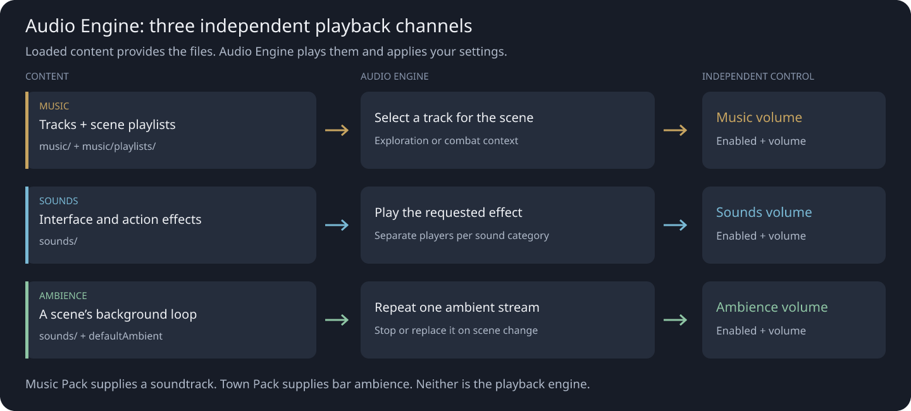
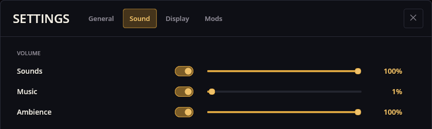

# Audio Engine — 音乐、音效与环境音

Audio Engine 让游戏有了声音的活力：音乐跟随当前场景，音效响应操作，一段环境音循环则烘托一个地点的氛围。这几层音轨各有独立的音量控制，因此可以把配乐调低，同时保留界面点击声和环境声响。

它是一个由菜单和游戏共用的引擎模组。通常你不需要直接打开或操作 Audio Engine：游戏向它提供音频文件并请它播放。



## 你会听到什么

- **音乐：** 场景的播放列表提供曲目。当前曲目播完后，播放器会挑选下一首，并在有其他选择时避开刚放过的那首。只有一首曲子的列表会循环它。
- **音效：** 界面点击、战斗动作之类的短促效果。不同音效类别可以同时叠放；同一类别里的新音效会取代上一个。
- **环境音：** 一个地点的背景声，例如来自 Town Pack 的酒馆氛围。同一时刻只播放一路环境音，并循环直到被停止或替换。

音乐和环境音是两回事，即使两者都在背景播放。一个地点可以在音乐频道放探索配乐，同时在环境音频道放另一路室内或户外循环。

## 调节声音

在菜单打开**设置 → 声音**。三行分别是**音效**、**音乐**和**环境音**。每行都有开关和自己的音量滑块。改动即时保存。



例如，把**音乐**调低就能更清楚地听清对话相关或界面的音效，而不用动**音效**。想只要配乐、不要环境循环，就关掉**环境音**。

设置面板由 Menu 模组提供；Audio Engine 负责把这些偏好应用到播放上，自己不会再加一个声音设置窗口。

## 用在哪里

- 共享前端为主菜单和设置加载 Audio Engine，即使没有任何游戏在运行。
- Music Pack 提供菜单主题和共享的探索、战斗播放列表；由 Audio Engine 播放。
- 在小说模板里，酒馆场景请求 `bar/bar_ambient`，由 Town Pack 提供。
- 剧情和战斗系统随游戏进程请求音效或切换当前的音乐上下文。

**Audio Engine 与 Music Pack 分工不同。** Audio Engine 负责播放，Music Pack 提供特定的配乐和播放列表。作者也完全可以把 Audio Engine 搭配其他音频内容使用。

## 给游戏作者：添加配乐

在内容模组已有的 `depends` 列表里加上 `audio_base>=1`。同时安装该模组并把它放进目标游戏的合集：内容模组装好了并不会自动进入每一款游戏。

```jsonc
// 加到 manifest 已有的依赖列表里：
"depends": ["audio_base>=1"]
```

音乐放在 `music/` 下，音效和环境循环放在 `sounds/` 下。新的示例请使用 Ogg Vorbis（`.ogg`）；自带的配乐和酒馆环境音用的就是这种格式。

```filestree
my_audio_content/
├── manifest.json
├── music/
│   ├── evening_theme.ogg
│   └── playlists/
│       └── my_scene.json
└── sounds/
    └── my_room/
        └── ambience.ogg
```

`music/playlists/my_scene.json` 的示例：

```json
{
  "Scene": "my_scene",
  "Musics": [
    {
      "MusicType": "Ambient",
      "MusicNames": ["evening_theme"]
    }
  ]
}
```

`Scene` 必须与场景的逻辑名一致。曲目名相对于 `music/`，不带扩展名。请保留资源名称原本的拼写、大小写和空格。

这里 `MusicType: "Ambient"` 指探索**音乐**。它不会把曲目送进独立的环境音通道。

## 给游戏作者：给场景配环境循环

在场景定义中把 `defaultAmbient` 设为相对 `sounds/` 的声音资源，不带扩展名：

```json
{
  "name": "my_scene",
  "defaultAmbient": "my_room/ambience"
}
```

这个片段只演示与声音有关的字段；场景需要的其他字段照常保留。`defaultAmbient` 为空的场景会停止上一幕场景的环境循环。

真实的例子是小说模板的 `my_novel_bar` 场景：它用 `defaultAmbient: "bar/bar_ambient"`，音频由 Town Pack 提供。要在自己的模组里复用这个资源，同样需要声明对它的所有者 `town_pack` 的依赖。

## 场景切换、战斗与覆盖

- 如果场景没有可用的播放列表，Audio Engine 会去找共享的 `default` 播放列表。只有在确有匹配的音频内容时才会有音乐。
- 场景专属的播放列表存在时，不会用 `default` 里缺失的音乐类型来补齐。请把它所需的音乐类型放进去。
- 切换场景时，当前曲目可以继续播放——只要它还在新列表里，且音乐类型未变。
- 进入战斗时可以记下探索曲目及其播放位置；回到探索时会尝试恢复。这是实时播放行为，并不保证读档能恢复到精确的音乐时间点。
- 同一场景、同一音乐类型下，后加载的模组会替换先前的曲目列表，两个列表不会拼接。相对名称相同的资源文件同样可能被后加载的模组覆盖。

战斗音乐上下文请使用 **Combat** 桶。随手起一个桶名并不会创建新的上下文，也不会多出一个设置滑块。

## 如果一片寂静

1. 检查**设置 → 声音**里对应的开关和音量。音乐、音效和环境音彼此独立。
2. 检查所选游戏是否加载了 Audio Engine 和所需的内容模组。Audio Engine 本身不包含 Music Pack 的曲目，也没有 Town Pack 的酒馆循环。
3. 音乐方面，检查场景名、所需的 `Ambient` 或 `Combat` 桶，以及每个曲目名。播放列表里的引用不会创建或下载音频文件。
4. 环境音方面，检查 `defaultAmbient` 和 `sounds/` 下的资源。如果上一个循环停了，检查新场景的这个字段是否为空。
5. 检查可能替换播放列表桶或音频资源的后加载模组。查一查游戏日志里缺失的音频文件或播放列表解析错误。

本指南采用的是受支持的 Ogg Vorbis 路径。引擎也有 WAV 加载路径，但当前加载器不解析 WAV 容器元数据；别想当然地认为任何导出的 WAV 都表现正常。拿不准时，把新内容转成 Ogg Vorbis。当前的音频工厂不支持 MP3。
